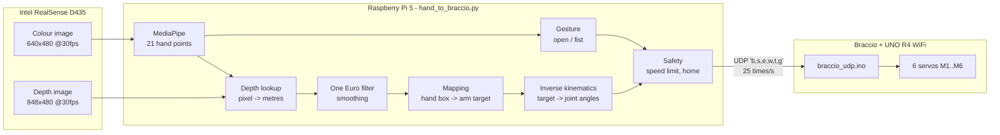

# 01 System Overview

## In one sentence
The **D435** sees your hand → the **Pi 5** works out where your hand is in 3D and what shape it is → it converts that into **six servo angles** → sends them as a short text message over **WiFi (UDP)** → the **Arduino UNO R4 WiFi** on the arm moves the servos.

## The whole chain

## The four questions the program answers every frame
1. **Is there a hand, and is it really a hand?** MediaPipe plus a 0.3 s "hold still" check. See [[Debouncing and State Machines]].
2. **Where is it, in metres?** Colour pixel + depth → X, Y, Z. See [[Depth Camera and 3D Points]].
3. **What shape is it?** Open palm or fist. See [[Gesture Classification]].
4. **What should the arm do?** Hand box → gripper target → joint angles → servo numbers. See [[Absolute vs Relative Control]], [[Inverse Kinematics]] and [[Servo Angles, Offsets and Calibration]].

## Three coordinate systems (the source of most confusion)

| Frame | Origin | Axes | Used for |
|---|---|---|---|
| **Image** | top-left pixel | u → right, v ↓ down (pixels) | MediaPipe output |
| **Camera** | centre of the D435 lens | x → right, y ↓ **down**, z → **away from the camera** (metres) | Hand position |
| **Robot (side view)** | the base, on the board | *reach* = horizontal distance out, *height* = up from the board (metres); *base angle* = which way it faces | IK |

> [!important] Why "hand up" means **negative y**
> In camera coordinates y points **down** (like image rows). So raising your hand makes y smaller. That's why the code uses `-y` for height. The same idea explains `MIRROR_X`: you face the camera, so your right hand appears on the left of the image.

## Two programs share the arm
The arm also accepts the same UDP messages from the **Quest 3 app** (the VR project). Both send to port 5005, so **only run one at a time**. Otherwise the arm gets two sets of commands and jerks between them.

## What runs where

| Device | Runs | Language |
|---|---|---|
| Raspberry Pi 5 | everything in `~/braccio-vision` | Python 3.11 in the `braccio-venv` virtual environment |
| UNO R4 WiFi | `braccio_udp.ino` (from the earlier Quest project) | Arduino C++ |
| Mac | nothing at run time; only used to download files to the USB drive | |

Next: [[02 Hardware and Network]]
