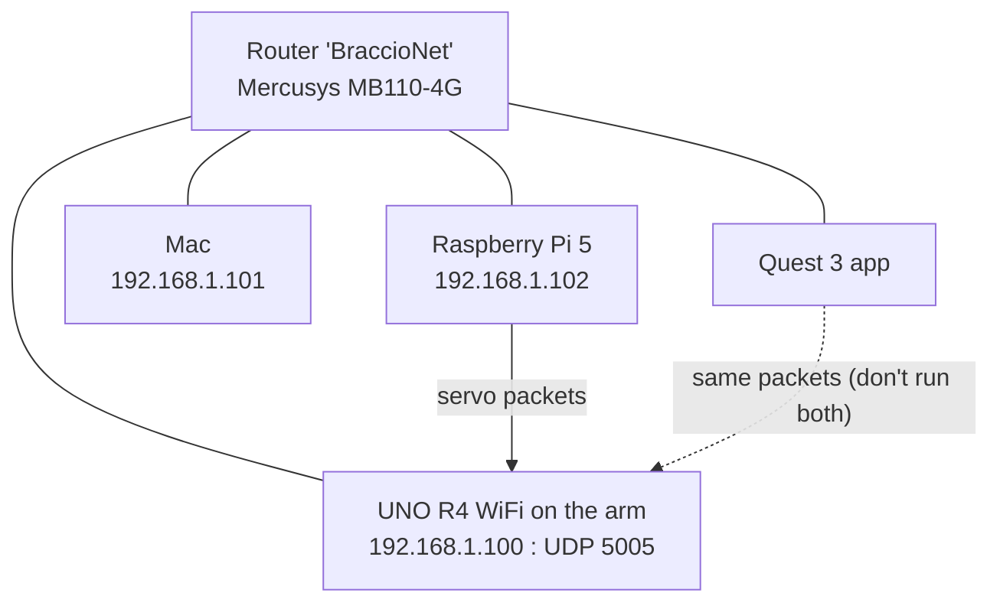

# 02 Hardware and Network

## Parts
| Part | Role | Notes |
|---|---|---|
| Raspberry Pi 5 (8 GB) | The brain: camera, AI, maths | Use the official **27 W 5V 5A** supply, otherwise USB power is limited |
| Raspberry Pi OS **Bookworm 64-bit** | Operating system | **Not Trixie**: Trixie's Python 3.13 breaks MediaPipe |
| Intel RealSense **D435** | Colour + depth camera | Must be on a **blue USB 3** port with a USB 3 cable. Depth works from about **0.28 m** |
| AI HAT+ | Not used yet | For later object recognition (YOLO) |
| TinkerKit **Braccio** | 6-servo arm | M1 base, M2 shoulder, M3 elbow, M4 wrist up/down, M5 wrist twist, M6 gripper |
| Arduino **UNO R4 WiFi** + Braccio shield | Moves the servos | Runs `braccio_udp.ino`, listens on UDP port 5005 |
| Mercusys MB110-4G router | Private network **BraccioNet** | Gives fixed addresses (DHCP reservation) |
| Mini tripod | Holds the camera | Best at chest height, pointing straight at you |

## Network map



> [!note] The arm's address is fixed
> The router always gives the arm **192.168.1.100** (a "DHCP reservation"). The Control Panel remembers it in `arm_ip.txt`. If the router is ever reset, check the arm's address in the router admin page and type the new one into the panel.

## Physical layout for gesture control

```
          [ ARM on its board ]  ← beside the camera, front facing you

  [ CAMERA ]  ─────── ~60 cm ───────  YOU
  chest height,                      hand in front of your chest
  pointing straight at you
```

- Nothing should be between the camera and your hand, including the arm.
- The arm treats the **board it stands on** as the floor (height 0). Objects must be **on the board**, 22–30 cm in front of the base.

## The servo packet (what actually goes over WiFi)
A plain text line with six whole numbers, for example:
```
90,82,21,12,90,20
```
In order: **base, shoulder, elbow, wristUpDown, wristTwist, gripper**, in degrees from 0 to 180. Gripper: 10 is wide open and 73 is fully closed. The code uses 20 (open) and 70 (closed). See [[UDP Networking]].

## Servo limits from braccio_udp.ino
| Servo | Min | Max | 90 means |
|---|---|---|---|
| M1 base | 0 | 180 | facing straight ahead |
| M2 shoulder | 15 | 165 | upper arm vertical |
| M3 elbow | 0 | 180 | forearm in line with upper arm |
| M4 wrist | 0 | 180 | gripper in line with forearm |
| M5 twist | 0 | 180 | neutral |
| M6 gripper | 10 | 73 | (10 open, 73 closed) |

"All 90" is the **candle pose**: everything straight up.
