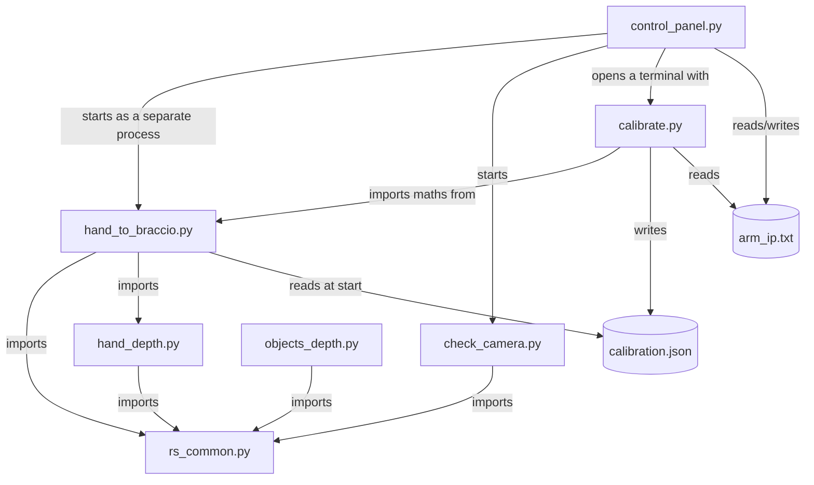

# 03 Folder Map

Everything lives in **`~/braccio-vision`** on the Pi (`~` means your home folder, `/home/braccio`).

```
~/braccio-vision/
├── setup_pi.sh            one-time installer (camera driver, Python libraries, hand model)
├── rs_common.py           shared: start the D435, colour depth images
├── check_camera.py        test 1: does the camera work? FPS, distance, depth quality
├── hand_depth.py          test 2: hand points + gesture + 3D position (no arm)
├── objects_depth.py       test 3: find the table and objects on it (for point-to-pick, later)
├── hand_to_braccio.py     ★ MAIN: hand → arm (simulation, arm check, LIVE)
├── calibrate.py           match the real arm to the model; writes calibration.json
├── joint_test.py          moves one joint at a time to diagnose problems
├── control_panel.py       ★ the desktop window with buttons
├── install_shortcuts.sh   puts "Braccio Control Panel" on the desktop
├── launch/                older terminal launchers (still work, panel replaces them)
│   ├── common.sh  live.sh  sim.sh  check.sh  camera_test.sh
├── models/
│   └── hand_landmarker.task   MediaPipe's hand AI model (downloaded by setup)
├── README.md              short setup readme
│
│   ── files created while you use it ──
├── calibration.json       your arm's corrections (written by calibrate.py)
├── arm_ip.txt             the arm address typed in the panel
└── table_plane.json       the table's position (written by objects_depth.py)
```

Outside the folder:
| Path | What |
|---|---|
| `~/braccio-venv/` | The Python **virtual environment**: a private copy of Python plus the libraries (numpy, opencv, mediapipe, pyrealsense2). See [[Terminal Basics#Virtual environments]] |
| `~/librealsense/` | Source code of the camera driver, built by `setup_pi.sh` |
| `~/Desktop/braccio-control-panel.desktop` | The desktop icon |
| `/boot/firmware/config.txt` | Pi settings; `usb_max_current_enable=1` is added here |

## How the files depend on each other



> [!tip] Why are the files split like this?
> Each test script proves **one layer** works before the next layer is built on top: camera → hand → arm. When something breaks, you go back down the layers. This is the most useful debugging habit in robotics.
