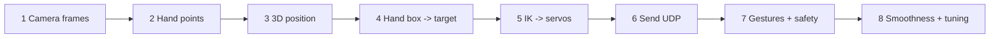

# How hand_to_braccio Was Built

The main program wasn't written in one go. It grew in **layers**, and each layer was tested before the next. Rebuilding it in the same order is the best way to understand it.



---

## Stage 1: get frames
```python
from rs_common import start_pipeline
rs, pipe, profile, scale = start_pipeline()
while True:
    frames = pipe.wait_for_frames()
    depth, color = frames.get_depth_frame(), frames.get_color_frame()
```
✅ Test: [[check_camera.py]] shows about 30 FPS.

## Stage 2: find the hand
```python
landmarker = vision.HandLandmarker.create_from_options(vision.HandLandmarkerOptions(
    base_options=mpt.BaseOptions(model_asset_path="models/hand_landmarker.task"),
    running_mode=vision.RunningMode.VIDEO, num_hands=1))
res = landmarker.detect_for_video(mp.Image(image_format=mp.ImageFormat.SRGB, data=rgb), timestamp_ms)
lms = res.hand_landmarks[0]          # 21 points, x and y from 0 to 1 (fraction of the image)
```
`VIDEO` mode uses the previous frame to track faster, so it needs an increasing timestamp. See [[MediaPipe Hand Landmarks]].

## Stage 3: real 3D position
Colour pixel → matching depth pixel → median depth → `rs2_deproject_pixel_to_point` → (x, y, z) metres. See [[hand_depth.py#depth_at_color_pixel - the clever bit]] and [[Depth Camera and 3D Points]].
✅ Test: [[hand_depth.py]] shows the wrist Z matching a tape measure.

## Stage 4: hand position → where the gripper should go
Define a **box** in front of the camera and stretch it onto the arm's workspace:
```python
base   = lerp_clamped(-x, (-0.20, 0.20), (40, 140))    # degrees
reach  = lerp_clamped(z, (0.40, 0.80), (0.32, 0.20))    # closer hand -> further reach
height = lerp_clamped(-y, (-0.18, 0.18), (0.03, 0.22))  # higher hand -> higher gripper
```
See [[Absolute vs Relative Control]].

## Stage 5: inverse kinematics → servo numbers
`ik(reach, height)` → three link angles → `to_servos(...)` → six servo values. This is the maths core: [[Inverse Kinematics]], [[Servo Angles, Offsets and Calibration]].
✅ Test (no camera needed): 100 random targets, all reached within 4.5 mm in the model.

## Stage 6: talk to the arm
```python
sock = socket.socket(socket.AF_INET, socket.SOCK_DGRAM)
sock.sendto(b"90,82,21,12,90,20", ("192.168.1.100", 5005))
```
See [[UDP Networking]]. Before any real movement: **simulation** (`draw_sim`), then **`--check`** (3 known poses), then LIVE.

## Stage 7: gestures and safety
- Gesture from finger geometry: [[Gesture Classification]].
- Debounce (must persist 6 frames), a hold-still start (8 frames), and a hold while changing shape: [[Debouncing and State Machines]].
- Speed limit per packet, home after 2 s without a hand, `finally: send(HOME)`: [[Safety Design]].

## Stage 8: make it feel right (real-world tuning)
Nearly everything here came from **testing on the real arm**, not from theory. See [[Change Log]].
| Problem seen | Fix |
|---|---|
| Jittery, laggy | [[One Euro Filter]] instead of simple averaging |
| Gripper flickered open/closed | open = open, fist = close; in-between shapes ignored |
| Arm 15 cm too high | [[calibrate.py]] offsets (shoulder −12, wrist −10) |
| Wrist twisted when hand moved up/down | twist disabled by default |
| Stiff bent wrist when high | gripper angle depends on height |
| Hand and arm drifted apart | **absolute** mode as default |
| Arm folded over itself near the base | upper arm may not lean back, minimum reach 20 cm |
| Wrong "fist" label | gesture from MediaPipe's own 3D model (no depth noise) |

## The testing trick that made this possible without the arm
A **fake camera** test replaced `pyrealsense2` and MediaPipe with tiny stand-ins that produce a scripted hand path ("open, move, close, flicker…"), and recorded every UDP packet. Each fix was checked against rules like "joint change ≤ 6 per packet", "gripper never toggles on a 1-frame glitch" and "last packet is HOME". This is called **mocking**: a standard way to test hardware code on a laptop.

Next: [[Learning Path and Exercises]]
