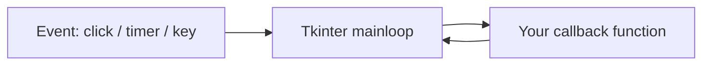
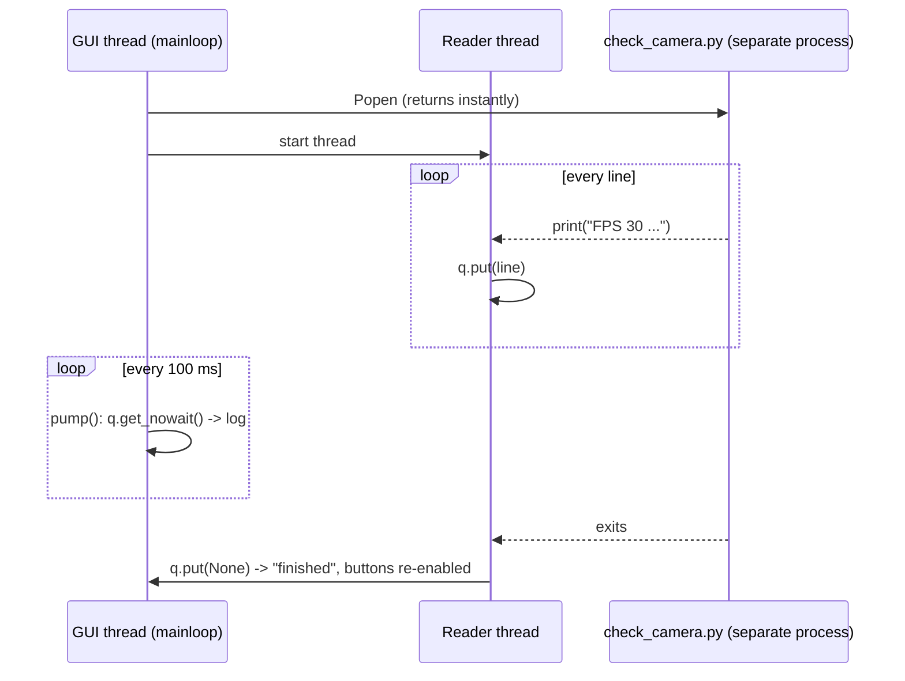

# How the Control Panel Was Built

A hands-on rebuild of [[control_panel.py]] in **7 steps**, from an empty window to the real thing. Every step is a complete program you can run on the Pi:
```bash
cd ~/braccio-vision    # work here, so step 5 can find check_camera.py
nano step1.py          # paste the code, Ctrl+O, Enter, Ctrl+X
~/braccio-venv/bin/python step1.py
```

> [!abstract] The 4 ideas you'll learn
> 1. **Widgets + layout**: labels, buttons and boxes, and how `pack()` stacks them.
> 2. **Event-driven programming**: you don't write the loop, Tkinter does; you write *callbacks*.
> 3. **Running other programs** with `subprocess`.
> 4. **Threads + a queue**, so slow work never freezes the window.

---

## Step 1: an empty window
```python
import tkinter as tk

root = tk.Tk()                       # the main window
root.title("Braccio Control Panel")
root.minsize(400, 300)
root.mainloop()                      # hand control to Tkinter: it now waits for clicks forever
```
`mainloop()` is the key idea. It is an **endless loop inside Tkinter** that waits for events (clicks, key presses, timers) and calls your functions. Your code **never** loops itself; it just reacts.



---

## Step 2: widgets and layout
```python
import tkinter as tk

root = tk.Tk()
root.title("Braccio Control Panel")
root.configure(bg="white")

tk.Label(root, text="Braccio gesture control", font=("Sans", 18, "bold"), bg="white").pack(pady=(14, 2))
tk.Label(root, text="Emergency stop: pull the arm's 5V plug", fg="#c0392b", bg="white").pack()

box = tk.LabelFrame(root, text=" Before you start ", bg="white", padx=10, pady=4)
box.pack(fill="x", padx=12, pady=8)
for line in ["1. Router on", "2. Arm 5V on", "3. Camera in a BLUE port"]:
    tk.Label(box, text=line, bg="white", anchor="w").pack(fill="x")

root.mainloop()
```
| Concept | Meaning |
|---|---|
| **Widget** | any visible thing: `Label`, `Button`, `Entry` (text box), `Text` (multi-line), `Canvas` (drawing), `Frame` (invisible container), `LabelFrame` (container with a title border) |
| **Parent** | the first argument. `tk.Label(box, …)` puts the label **inside** `box` |
| **`pack()`** | the layout manager: stacks widgets top to bottom (or `side="left"` for a row) |
| `fill="x"` | stretch to the full width |
| `padx`, `pady` | space around (a pair like `(14, 2)` = top 14, bottom 2) |

> [!note] A widget is invisible until you call `pack()` (or `grid()`/`place()`).

---

## Step 3: buttons and callbacks
```python
import tkinter as tk

def start_live():
    status.set("LIVE pressed!")      # change the label's text

root = tk.Tk()
status = tk.StringVar(value="Ready")    # a 'live' string: labels using it update automatically

tk.Button(root, text="LIVE\nhand controls the real arm", width=22, height=3,
          bg="#2e9d4f", fg="white", font=("Sans", 11, "bold"),
          command=start_live).pack(pady=4)          # command = the function to call on click
tk.Label(root, textvariable=status).pack()
root.mainloop()
```
- `command=start_live`: pass the function **itself**, without `()`. Writing `start_live()` would call it immediately, once, at start-up.
- `StringVar`: change it with `.set()` and every widget using it updates. The real panel uses one for the status line and one for the Arm IP box (`tk.Entry(textvariable=self.ip)`).

In the real file, the five buttons are made in a **loop** from a list of `(text, subtitle, colour, function)`, so adding a mode is one line.

---

## Step 4: status lights with a Canvas
```python
import tkinter as tk
GREEN, RED, GREY = "#2e9d4f", "#c0392b", "#9a9a9a"

def make_light(parent, label):
    c = tk.Canvas(parent, width=18, height=18, highlightthickness=0)
    c.pack(side="left", padx=(10, 2))
    dot = c.create_oval(2, 2, 16, 16, fill=GREY, outline="")   # a circle
    tk.Label(parent, text=label).pack(side="left")
    return c, dot

def set_light(light, ok):
    c, dot = light
    c.itemconfig(dot, fill=GREY if ok is None else (GREEN if ok else RED))

root = tk.Tk()
row = tk.Frame(root); row.pack(pady=10)
cam = make_light(row, "Camera")
arm = make_light(row, "Arm")
tk.Button(root, text="Camera OK", command=lambda: set_light(cam, True)).pack()
tk.Button(root, text="Arm FAIL", command=lambda: set_light(arm, False)).pack()
root.mainloop()
```
- **Three states**: `None` = grey (checking), `True` = green, `False` = red.
- `lambda: set_light(cam, True)` makes a tiny unnamed function. It's needed because `command=` takes a function with **no** arguments.

---

## Step 5 - run a script without freezing the window
This is the heart of the panel. First, the **wrong** way:
```python
def start_test():
    out = subprocess.run(["python", "check_camera.py"], capture_output=True, text=True)  # takes 10+ s
    log.insert("end", out.stdout)
```
While `subprocess.run` waits, `mainloop` can't run, so the window **freezes**: no redraw, no STOP button. Never block the GUI thread.

The **right** way: start the program (`Popen` returns immediately), let a **background thread** read its output, and pass lines to the GUI through a **queue**:

```python
import queue, subprocess, sys, threading
import tkinter as tk

q = queue.Queue()            # thread-safe mailbox
proc = None

def run(args):
    global proc
    proc = subprocess.Popen([sys.executable, "-u"] + args,
                            stdout=subprocess.PIPE, stderr=subprocess.STDOUT,
                            text=True, bufsize=1, start_new_session=True)
    def reader(p):                       # runs in the BACKGROUND thread
        for line in p.stdout:            # blocks waiting for each line: fine here
            q.put(line)
        p.wait()
        q.put(None)                      # "finished" signal
    threading.Thread(target=reader, args=(proc,), daemon=True).start()

def pump():                              # runs on the GUI thread every 100 ms
    try:
        while True:
            line = q.get_nowait()        # never blocks
            log.insert("end", "=== finished ===\n" if line is None else line)
            log.see("end")               # scroll to the bottom
    except queue.Empty:
        pass
    root.after(100, pump)                # schedule myself again

root = tk.Tk()
tk.Button(root, text="Run camera test", command=lambda: run(["check_camera.py"])).pack()
log = tk.Text(root, height=15, bg="#111", fg="#ddd"); log.pack(fill="both", expand=True)
root.after(100, pump)
root.mainloop()
```



| Detail | Why |
|---|---|
| `sys.executable` | the same Python (venv) that runs the panel |
| `-u` | unbuffered: lines arrive immediately, not in chunks |
| `stderr=STDOUT` | error messages also go to the log |
| `daemon=True` | the thread dies automatically when the window closes |
| `root.after(100, pump)` | the **Tkinter-safe** way to repeat work: a timer, not a loop |

The status checks (`refresh`) use the same pattern: a thread runs the slow `ping` / camera check, then hands the result back with `self.root.after(0, lambda: self._show_checks(...))`, because only the GUI thread may touch widgets.

---

## Step 6: STOP safely
```python
import os, signal
def stop():
    if proc and proc.poll() is None:              # poll() is None = still running
        os.killpg(proc.pid, signal.SIGINT)        # same as pressing Ctrl+C
```
- `start_new_session=True` (step 5) gave the script its **own process group**. `killpg` signals the whole group, so helpers the script started are stopped too.
- **SIGINT** (not kill!) lets Python raise `KeyboardInterrupt`, so `hand_to_braccio.py` runs `finally: sender.send(HOME)` and the arm goes home. The panel waits 4 s, then sends **SIGTERM** if it's still alive. That's a last resort: the arm may not get HOME then, and the servos simply stay at their last position.

| Signal | Like | Script can clean up? |
|---|---|---|
| SIGINT | Ctrl+C | ✅ yes (`KeyboardInterrupt`) |
| SIGTERM | "please quit" | only if it installs a handler; plain Python just exits, **without** running `finally` |
| SIGKILL | pulling the plug | ❌ never; avoid it for the arm |

---

## Step 7: organise it as a class
The real file wraps everything in `class Panel`, so all widgets and state live on `self` instead of global variables:
```python
class Panel:
    def __init__(self, root):
        self.proc = None
        self.q = queue.Queue()
        ...build widgets...
        root.after(200, self.pump)
        root.after(300, self.refresh)

    def run(self, label, args): ...
    def pump(self): ...
    def stop(self): ...

root = tk.Tk(); Panel(root); root.mainloop()
```
Extras in the real version:
- `busy(True/False)` disables the mode buttons while running and enables STOP.
- `need_camera()` and the `arm_reachable()` checks run before modes start, with `messagebox.askokcancel` confirmations.
- `root.protocol("WM_DELETE_WINDOW", self.on_close)` catches the window's ✕ button, so you can't close it with the arm moving.
- `arm_ip.txt` saves the IP box between runs.

---

## Exercises
1. Add a **"Objects test"** button that runs `objects_depth.py --show`. *(Hint: one line in the button list, plus a `start_objects` method like `start_camera`.)*
2. Make the **Arm light** re-check itself every 10 s while idle. *(Hint: `root.after(10000, self.refresh)` at the end of `_show_checks`.)*
3. Add a **"Save log"** button that writes `self.log.get("1.0", "end")` to `log.txt`.
4. Show the Pi's **temperature** in the status row. *(Hint: `vcgencmd measure_temp` in a thread.)*

Related: [[control_panel.py]], [[Terminal Basics]]
