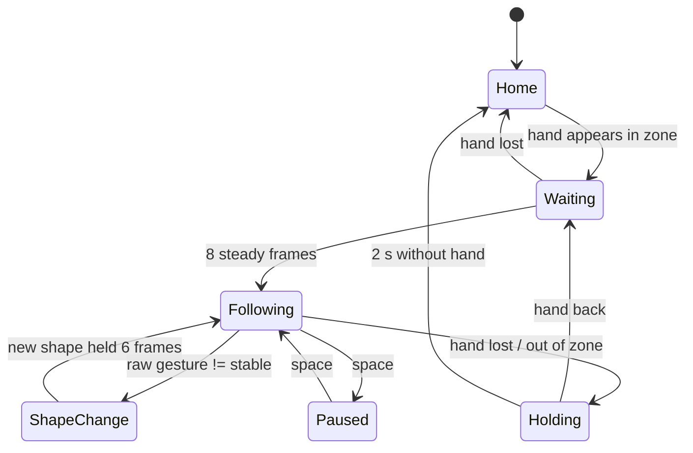

# Debouncing and State Machines

## Debouncing
A **bounce** is a quick false flip: one frame says *fist* while your hand is open. Robots must not react to single frames.

**Rule:** a new gesture only counts after it's seen **`GESTURE_FRAMES` = 6 frames in a row** (≈ 0.2 s at 26 fps).
```python
if raw == cand:
    cand_count += 1          # same as last frame: count up
else:
    cand, cand_count = raw, 1    # different: start counting this new candidate
if hand_state and cand_count >= GESTURE_FRAMES:
    stable = hand_state      # accepted
```
`stable` is what the arm uses. `cand` is "maybe".

## Hysteresis: ignore the in-between
Only **clear** shapes change the state: *open* → OPEN, *fist/pinch* → CLOSED. `point` and `unknown` (half-closed hands) keep the old state. So closing your hand slowly can't make the gripper chatter.

## The "hold still" rules
| Rule | Setting | Why |
|---|---|---|
| Hand must be steady **8 frames** (≈ 0.3 s) before the arm moves | `START_FRAMES` | a one-frame false detection (a face, a pattern) can't jerk the arm |
| Arm **holds** while the raw shape ≠ the accepted state | built in | closing your fist shifts your wrist a bit; the arm shouldn't drift sideways as you grab |
| No valid hand for **2 s** → HOME | `NO_HAND_HOME_S` | walking away leaves the arm safe |

## The whole thing as a state machine

A **state machine** is just "what mode am I in, and what event moves me to another mode". Drawing one before coding prevents most "it does something weird when…" bugs.
