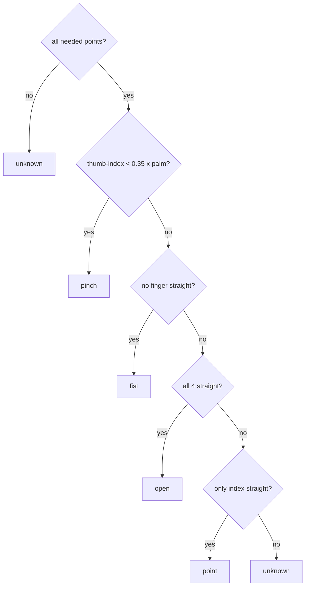

# Gesture Classification

`classify_gesture(p)` in [[hand_depth.py]] uses **plain geometry, no AI**, on the 21 points.

## Rule 1: is a finger straight?
```python
def extended(tip, pip):
    return dist(tip, wrist) > dist(pip, wrist) * 1.1
```
A straight finger's tip is **further from the wrist** than its middle knuckle. A curled finger's tip folds back **closer**. The `× 1.1` adds a margin so half-bent fingers don't count.

## Rule 2: pinch
Thumb tip close to index tip: `dist(thumb_tip, index_tip) < 0.35 × palm_width`.
Using the **palm width** (index knuckle to pinky knuckle) makes it work for any hand size and any distance.

## The decision


## How the arm uses it
| Raw | Counts as | Gripper |
|---|---|---|
| open | open | **open** (20) |
| fist, pinch | fist | **closed** (70) |
| point, unknown | *no change* | stays as it was |

A pinch counts as a fist because a closing hand passes through "pinch" on the way.

Then [[Debouncing and State Machines]] makes sure a single wrong frame can't flip the gripper.

## Why world landmarks?
Originally the gesture used **camera depth** for each finger point. At 1.5 m, depth on thin fingers was noisy: an open hand measured as "not straight", and the screen said *fist* while your palm was wide open. MediaPipe's world landmarks are the model's own 3D guess of the hand shape, which is steady at any distance.
