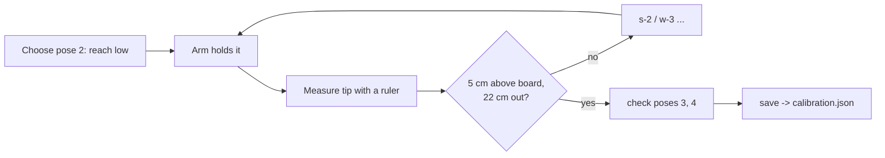

# Servo Angles, Offsets and Calibration

## Absolute vs relative angles
- IK gives **absolute** angles: each link measured from horizontal.
- Servos need **relative** angles: each joint measured from the link before it, with **90 = straight**.

```python
shoulder = 90 + SIGN·(a1 - 90)  + SHOULDER_OFFSET    # upper arm vs vertical
elbow    = 90 + SIGN·(a2 - a1)  + ELBOW_OFFSET       # forearm vs upper arm
wrist    = 90 + SIGN·(a3 - a2)  + WRIST_OFFSET       # gripper vs forearm
```
So in the **candle pose** (all links vertical: a1 = a2 = a3 = 90°) every servo is 90.

## SIGN: which way is "plus"?
If a joint turns the opposite way to the maths, its sign is −1. Your arm needed **no flips** (all +1), as confirmed by [[joint_test.py]].

## OFFSET: fixing small errors
Real arms aren't perfect:
- a servo horn not fitted exactly at centre (one spline tooth is over 10°, so assembly is rarely perfect)
- **sag**: the shoulder carries the whole arm; under load it falls a few degrees short
- the wrist horn or gripper weight adds more

Your arm: **shoulder −12, wrist −10** (sending a *smaller* number makes those joints lean/bend **further forward and down**, making up for the shortfall).

> [!note] Why fixing one pose is mostly enough
> An offset shifts every pose of that joint by the same amount. Horn errors are constant, so one pose fixes them. Sag changes with pose, so it's only approximately fixed. That's why accuracy is about 1–2 cm, not millimetres.

## Clamping
After offsets, every value is clamped to its limits (e.g. the shoulder stays 15–165). IK avoids needing clamping (`within_limits`), because a clamped joint means the tip isn't where the maths thinks.

## The calibration loop

Tool: [[calibrate.py]]
