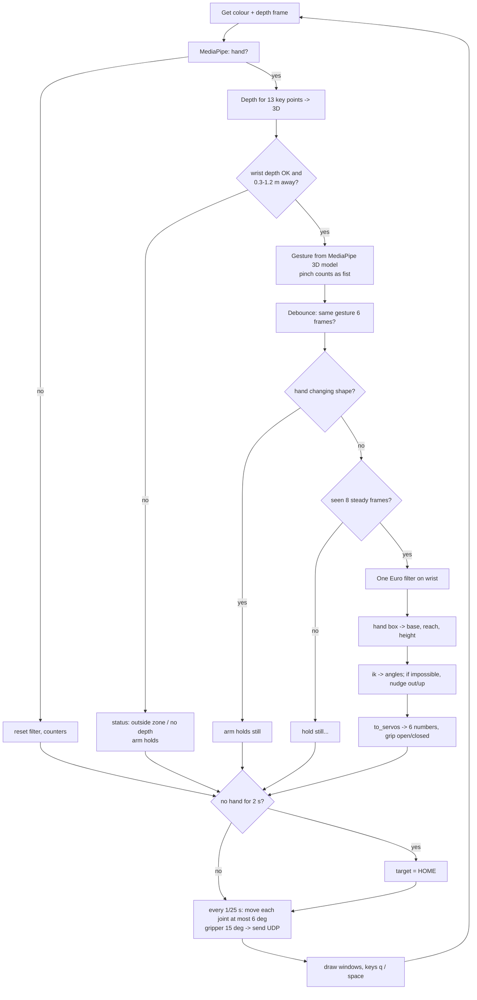

# hand_to_braccio.py ★

**Job:** the main program. Camera → your hand → arm.
**Run modes:**
```bash
python hand_to_braccio.py --show                              # SIMULATION (nothing sent)
python hand_to_braccio.py --check --show --arm-ip 192.168.1.100   # 3 test poses, then exit
python hand_to_braccio.py --show --arm-ip 192.168.1.100           # LIVE
```
| Flag | Meaning |
|---|---|
| `--arm-ip IP` | where to send packets. **Leave it out = simulation**: a safe default |
| `--show` | open the camera window + side-view simulation window |
| `--check` | send candle / reach low / reach high (4 s each), then home |
| `--model PATH` | a different hand model file (rarely needed) |

## The file in 5 sections
| Lines (approx.) | Section | Note |
|---|---|---|
| 36–113 | **Settings** (all tunable numbers) | [[Settings Reference]] |
| 58–73 | Loads `calibration.json` if present | [[Servo Angles, Offsets and Calibration]] |
| 116–173 | **Filter + mapping**: `lerp_clamped`, `OneEuro`, `relative_target`, `hand_to_target` | [[One Euro Filter]], [[Absolute vs Relative Control]] |
| 176–239 | **Arm maths**: `within_limits`, `ik`, `fk`, `to_servos`, `servos_to_abs`, `palm_roll_deg` | [[Inverse Kinematics]] |
| 241–299 | **Output**: `draw_sim`, `Sender`, `run_check` | [[UDP Networking]] |
| 301–489 | **`main()`**: the live loop | below |

## Functions, one by one

### `lerp_clamped(v, src, dst)`
"Linear interpolation, clamped." Maps `v` from range `src` to range `dst`, never going outside.
Example: hand x from (−0.20, 0.20) m → base (40, 140)°. x = 0 → 90°; x = 0.25 (beyond the box) → clamped to 140°.

### `class OneEuro`
Smoothing filter for the wrist position. Steady when still, quick when moving. Full explanation: [[One Euro Filter]].

### `hand_to_target(wrist_xyz)` → `(base°, reach m, height m)`, absolute mode
```
x (left/right)          → base angle   (mirrored, because you face the camera)
z (distance to camera)  → reach        (closer → reaches further, NEAR_MEANS_FAR)
-y (up is negative y)   → height
```
Worked example: hand at x = +0.10, y = −0.05, z = 0.50 m → **base 65°, reach 0.29 m, height 0.15 m**.

### `relative_target(hand, anchor_hand, anchor_tip)`, relative mode
Moves the gripper by **how much** the hand moved since an anchor point, 1:1 in centimetres. Kept as an option (`CONTROL_MODE = "relative"`).

### `within_limits(a1, a2, a3)` → True/False
Would this pose need a servo **beyond its limits**, or have the upper arm leaning back (`a1 > UPPER_ARM_MAX_DEG`)? If so, reject it. This prevents the "arm folds over itself" pose seen in testing.

### ik - reach and height to joint angles
**Inverse kinematics**: which link angles put the gripper tip at (reach, height)? Tries gripper angles near the wanted one (pointing down when low, tilted when high) and both elbow bends, and returns the first that fits the limits. Full maths: [[Inverse Kinematics]].

### `fk(a1, a2, a3)`, forward kinematics
The opposite: angles → where each joint ends up. Used to draw the simulation and in tests.

### `to_servos(base, a1, a2, a3, twist, grip)` → `[6 ints]`
Converts absolute link angles (from horizontal) into **relative servo angles** (each joint relative to the previous link, 90 = straight), adds offsets, and clamps to limits. See [[Servo Angles, Offsets and Calibration]].

### `servos_to_abs(s)`
The inverse of `to_servos`, for drawing what the arm will **really** do.

### `draw_sim(servos, status)`
Draws the side view with OpenCV: grey base, orange upper arm, blue forearm, green gripper, and the six servo numbers.

### `class Sender`
Holds a UDP socket. `send([..6 numbers..])` → text `"90,82,21,12,90,20"` → arm. If no IP was given, it does nothing (simulation). See [[UDP Networking]].

### `run_check(sender, show)`
Sends **candle**, **reach low (22 cm, 5 cm)** and **reach high (28 cm, 18 cm)** for 4 s each. The `try/finally` guarantees `HOME` is sent even if you press STOP halfway.

## `main()`: the live loop, frame by frame



### Variables that carry state between frames
| Variable | Holds |
|---|---|
| `stable`, `cand`, `cand_count` | debounced gesture: the accepted one, the candidate, and how many frames in a row |
| `seen_frames` | how long the hand has been steadily in view (start delay) |
| `filt` | the One Euro filter's memory |
| `target` | current goal (base, reach, height, twist) |
| `anchor_hand`, `anchor_tip` | only for relative mode |
| `servos` | the **wanted** six servo values |
| `sent` | what was **actually sent** last (speed-limited towards `servos`) |
| `last_seen` | time the hand was last valid (for the 2 s home rule) |
| `paused` | space bar toggle |

### The speed limiter (the last safety layer)
```python
lim = [MAX_DEG_PER_SEND] * 5 + [GRIP_STEP]        # 6,6,6,6,6,15
sent = [round(p + clamp(t - p, -l, l)) for p, t, l in zip(sent, servos, lim)]
```
Whatever happens upstream (glitch, jump, going home), each joint moves at most 6° per packet × 25 packets/s = 150°/s. The arm keeps receiving packets even when paused, so it holds its pose.

### Shutdown
`try … except KeyboardInterrupt … finally: sender.send(HOME); pipe.stop(); landmarker.close()`
Ctrl+C, Q, or the panel's STOP (which sends Ctrl+C) all end in the `finally` block, so the **arm always gets HOME**.

## Wrist twist (currently off)
`TWIST_ENABLED = False`. When on, the knuckle line angle (`palm_roll_deg`) turns M5, with a 15° dead band. It was switched off because moving your hand up and down changed the measured roll and twisted the wrist by accident.

Build story: [[How hand_to_braccio Was Built]] · Settings: [[Settings Reference]]
